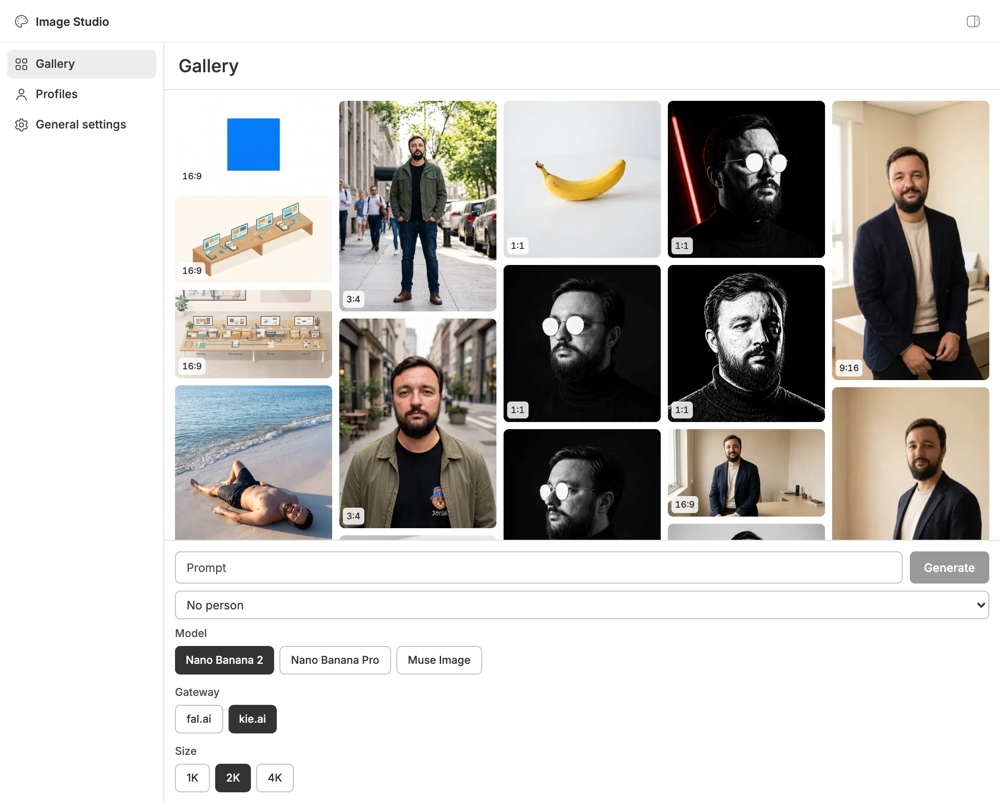
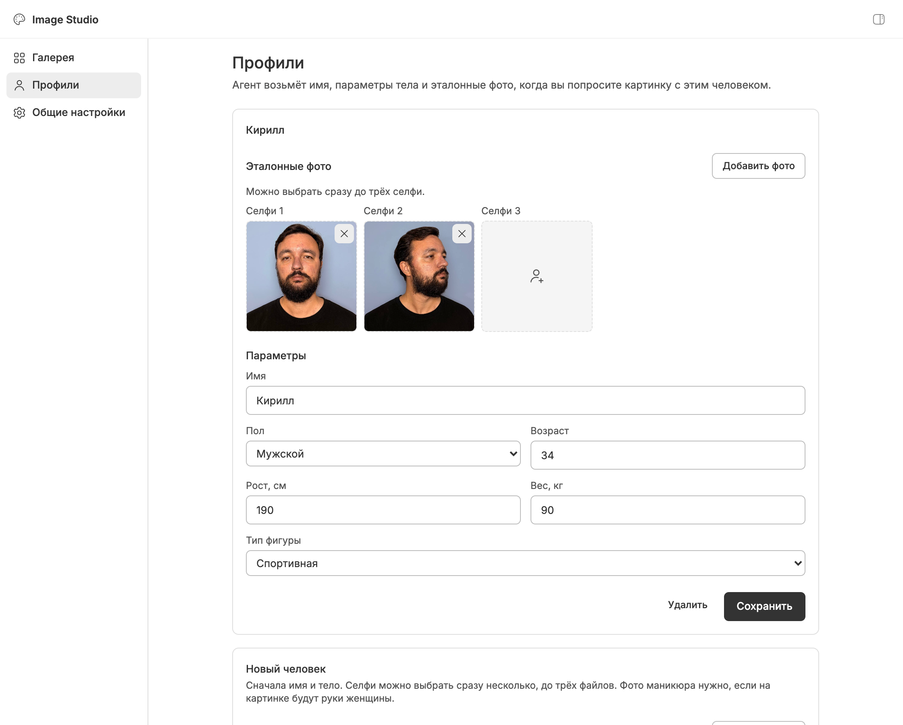
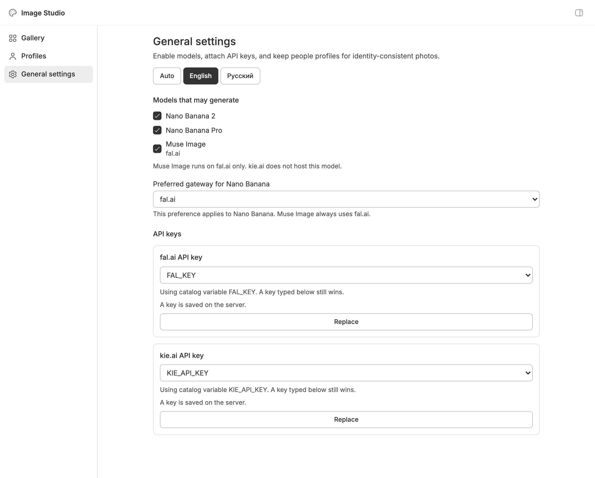

# Image Studio for BB

[](https://getbb.app)
[](LICENSE)

Generate project photos in BB through [fal.ai](https://fal.ai/) and [kie.ai](https://kie.ai/) (Nano Banana 2, Nano Banana 2.1, Nano Banana Pro, Muse Image, Wan 2.7), keep them in a gallery, and reuse people profiles with reference photos.

[Русский](README.ru.md) · [Releases](https://github.com/VKirill/bb-plugin-image-studio/releases)



## What it does

- **Gallery** — generated images for the current project, shown in real aspect ratios (not cropped squares). Click a thumbnail to preview. New files are WebP; older PNG files convert on first view.
- **Generate in the panel** — prompt, person profile, model, gateway, and Nano Banana size (default **2K**). Aspect ratio is not a panel filter; the model sets the frame. The gallery labels each photo (1:1, 4:5, 9:16, …).
- **Generate in chat** — ask the agent for a photo. It opens a Send form with the last model, aspect ratio, and size. Change them, then Send. The agent must call `image_studio_generate`, not `bb image-studio generate`.
- **People profiles** — name, body, and a labeled **reference sheet**: face (front, 3/4 left, 3/4 right, profile, smile), body in fitted clothing (front, side, back), and close-ups (hands, chest, waist, legs, buttocks, moles/tattoos, hair from behind). Each generation sends only the slots the prompt needs, within the model's image cap, so the same face and body carry across models. **Build sheet** generates the missing slots from the front face; results wait as candidates you accept. Profiles are shared across projects; outputs are per project. Older profiles migrate automatically: selfies become the first three face slots, the manicure becomes hands.
- **GUI** — interface work in **GUI projects**: generations from a folder go to that folder's project (created on first use, named after the folder), each with its own history grouped by request. A project also holds the theme, presets (cartoon, gothic, fantasy, sci-fi, horror, cozy, minimal, crystal, pixel), a five-colour palette, extra rules and up to six approved reference pictures, all added to every GUI prompt. Modes: **Ideas ×4** (four mockups of a screen: four directions for a fresh style, four takes inside a fixed one), **Screen**, **Elements** (a list drawn on a green-key sheet in a strict grid and cut into transparent PNGs named after the elements, optionally with normal / hover / pressed / disabled states) and **UI kit** (frame, panel, buttons, tabs, slider, toggles, checkbox, slots, bars in two cut sheets). Always Muse Image, English labels, full-size files in `image-studio/gui/<project>/` with `manifest.json`. Agents use the `image_studio_gui` tool or `bb image-studio gui …`.



- **Settings** — searchable dropdown to enable models, English or Russian UI, API keys. A key typed in settings overrides Env Catalog. **Muse Image is fal.ai only.** GPT Image 2.5, FLUX.2 Pro, Seedream 5, and Grok Imagine are off until you tick them.



On a phone, Gallery / GUI / Profiles / Settings sit in a bottom bar so the prompt field stays usable.

## Install

```sh
bb plugin install git:https://github.com/VKirill/bb-plugin-image-studio.git@^0.2.0 --yes
```

Or install **Image Studio** from the BB Community marketplace once the listing is merged.

Then:

1. Open **Image Studio** in the BB sidebar.
2. In **Settings**, open the models list, search if needed, tick the ones you want, and add a fal.ai and/or kie.ai key (or pick one from Env Catalog).
3. Optionally add a person under **Profiles**.
4. Generate from the gallery form, or ask an agent in a project thread for a photo.

## For agents

The bundled skill `image-studio` tells the agent to open the prompt template for the chosen model (Nano Banana, Muse, GPT Image 2.5, FLUX.2, Seedream, or Grok Imagine), then call `image_studio_generate` with the scene (and a profile name if you named a person). Do not pass model, aspect, or size unless the user named them in that turn. Wait until the user presses Send.

CLI (scripts, terminals, and hidden Agency workers; skips the chat picker). Preferred Nano Banana gateway is **kie**. Muse Image always uses **fal**. GPT Image 2.5, FLUX.2, Seedream, and Grok follow the preferred gateway. Pass `--gateway fal` only when you want Banana (or another dual model) on fal.ai.

```sh
bb image-studio generate --prompt "…"
bb image-studio generate --prompt "…" --gateway fal
bb image-studio generate --prompt "…" --model muse-image
bb image-studio generate --prompt "…" --model gpt-image-2.5-flare
bb image-studio generate --prompt "…" --profile Vika --refs auto          # default
bb image-studio generate --prompt "…" --profile Vika --refs all
bb image-studio generate --prompt "…" --profile Vika --refs face-front,body-back
bb image-studio profiles --json                                           # filled slots per profile
bb image-studio sheet --profile Vika --dry-run                            # plan, free
bb image-studio sheet --profile Vika [--slots body-back,chest] [--accept] # paid: one generation per slot
```

`refs` is `auto` (default), `all`, or a comma list of slot ids; the result names the slots sent (`refsUsed`). The `image_studio_generate` tool takes the same `refs`. `sheet` builds the empty reference slots (chest, buttocks and body slots with Qwen Image 2.1 on kie, the rest with Nano Banana Pro / 2.1 / 2, in that order of preference); `marks` is upload-only.

`--count N` makes N variants of one prompt in parallel; `--batch jobs.jsonl` runs one job per line (`prompt`, `model`, `gateway`, `profile`, `refs`, `image`/`images`, `aspect`, `resolution`, `count`). All provider calls share one queue: **Settings > Parallel generations** (default 8, 1–10), so parallel CLI calls, chat sends and sheet builds never exceed it. 429 and 5xx answers are retried with backoff. `sheet` builds in waves (faces, body, details), each wave in parallel (`--parallel N`; `--accept` lets a wave use the accepted photos of the previous one). Exit code 75 means a plugin reload cut the run before anything was saved: run it again.

A worker that cannot press Send must use this CLI, not `image_studio_generate`. Failures print on stderr (and as the RPC error text). After a failed fal call you should see an HTTP status and JSON from fal.ai, not `[object Object]`. Look at the CLI stderr or `bb plugin rpc call image-studio generate`.

## Reference selection

`refs: auto` is chosen by [Jev](https://docs.typesafe.ai/) (TypeSafe System One), reached through OpenLux by default (`https://api.openlux.ai/v1/systemone`, the same API as TypeSafe; TypeSafe direct is the fallback). One request per generate call asks, in parallel, which profile photos the picture needs, from which viewpoint, whether it is explicitly nude and whether it has a person. Code keeps the caps and hard rules. Timeout (2.5 s), error or no key: keyword rules. `bb image-studio refs --profile NAME --prompt "…"` previews the choice for free. On a 44-prompt evaluation set (`tests/fixtures`, `scripts/jev-eval.ts`) Jev matched the expected photos on 43 prompts, the keyword rules on 13.

## Safety fields

The plugin relaxes provider checks only where the endpoint's schema has a field (checked on the provider API pages): fal `safety_tolerance: "6"` on Nano Banana 2, 2.1 and Pro; `safety_tolerance: "5"` plus `enable_safety_checker: false` on FLUX.2 Pro; `enable_safety_checker: false` on Seedream 5, GPT Image 2.5, Grok Imagine and Wan 2.7; nothing on Muse Image (no such field). kie `nsfw_checker: false` on Qwen, Seedream, FLUX.2, Grok and Wan 2.7; nothing on Nano Banana or GPT Image (no such field). fal says disabling `enable_safety_checker` needs account authorization, otherwise requests are still checked, and the model's own filters (Google's on Nano Banana, fal's content checker on Muse) can still refuse.

## Requirements

- BB 0.43 or later
- A [fal.ai](https://fal.ai/) and/or [kie.ai](https://kie.ai/) account and API key (those providers bill generation)
- Optional: [Env Catalog](https://github.com/VKirill/bb-plugin-env-catalog) to store keys

## License

MIT
